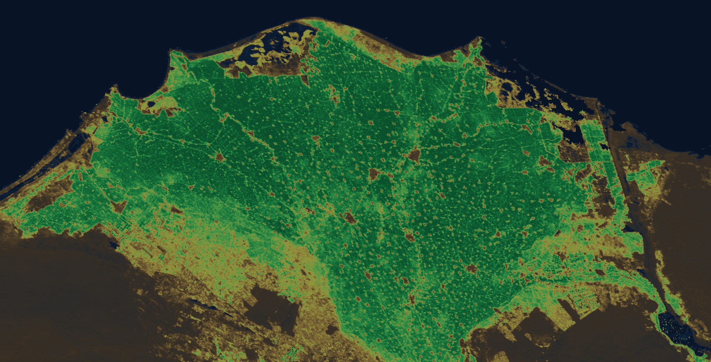

<h1 align="center">Field Shift: Egypt</h1>

<b>The right crop at the right time.</b> A voice assistant for Nile Delta farmers, built on NASA POWER weather, NASA MODIS satellite data and FAO tables.

<a href="docs/index.html">Project page (open docs/index.html, or GitHub Pages once enabled)</a> · <a href="docs/status.md">Status</a> · <a href="docs/decisions.md">Decisions</a> · <a href="docs/methodology.md">Method and limits</a>

---

NASA Space Apps Challenge 2026, challenge **"Field Shift: Adapting Farms with NASA Data"** (hackathon 14-15 November 2026). Team based in Egypt.

> **Status (15 Nov):** a working **Flutter Android app** (Arabic and English, light and dark) built on three tested calculation engines that use NASA POWER weather and FAO tables. Not yet tested on a real phone; voice depends on the phone's own speech support. Live status: [`docs/status.md`](docs/status.md). Every decision: [`docs/decisions.md`](docs/decisions.md).

## The problem (decision D1)
Farmers in the **Nile Delta** have to decide each season what to plant and when. Three pressures make that hard, and they interact:

1. **Water:** irrigation water is short and unreliable, worst at the tail ends of canals. In one western Delta study, 58% of tail-end farmers said growing rice had become very difficult, and rice yields fell 30-50% (ghazouani2014).
2. **Salty soil:** 57.2% of surveyed Delta farmers report rising soil salinity (kassem2019). Rice helps wash salt out but is the thirstiest crop, so salt and water pull in opposite directions.
3. **The wheat calendar:** when the summer crop is harvested late, wheat goes in late. Late wheat flowers in spring heat and in field trials lost about 40% of its yield (elbasyoni2018).

Underneath all three: **many farmers cannot read and get little advice.** 31.7% of surveyed Delta farmers are illiterate and most get information from their sons or TV (kassem2019). That is why the product is a voice assistant, not a dashboard.

Evidence for each claim is in [`literature/papers.csv`](literature/papers.csv) (58 papers; only papers whose full text was read count as evidence). Other candidate problems we considered: [`docs/problem_statement_options.md`](docs/problem_statement_options.md).

## What the app does
The farmer says (or types, or taps) where the field is, the summer crop, when it is sown, the wheat sowing date, how often canal water comes, and any salt signs. The app answers with a **comparison of the farmer's own rotation against two alternatives**: water need of the summer crop, heat during wheat grain filling for the chosen wheat sowing date, and how well each crop tolerates the soil salt. The farmer picks the place by tapping a map of Egypt's 27 governorates.

It **supports, and does not replace,** the farmer's judgement and local agricultural experts.

### The three engines (decisions D2, D7)
| Engine | Question it answers | Method | Data |
|---|---|---|---|
| Wheat calendar | "How much heat does wheat meet during grain filling if sown on date X, compared with other dates?" | Thermal time, shown only as a comparison of sowing dates against 15 November | NASA POWER daily temperature, 1990-2025 |
| Water | "How much water does the summer crop need, compared with my rotation?" | FAO-56 reference evapotranspiration times crop coefficients; shown as ratios, not millimetres | NASA POWER weather; crop tables from FAO-56 |
| Salt | "Can my soil take this crop?" | FAO paper 29 salt-tolerance table | Farmer input (soil test or signs). No NASA product measures soil salinity |

**Grounded, not fine-tuned (D2):** every number comes from these engines. The conversation itself is rule-based today; a language model could replace the understanding step later, but it would never calculate. Details, limits and the checks we did and did not do: [`docs/methodology.md`](docs/methodology.md).

### What we do not claim
No yield forecast, no yield loss in percent, no field-level or weather-station-validated accuracy. Weather is a model product at about 50 km; absolute hot-day counts are approximate, so the app compares dates. The salt percentage is a crop-tolerance figure from the FAO table, not a forecast of the farmer's crop. Several wheat parameters have no full-text source (marked low confidence in `models/`).

## NASA data we hold (see [`data/catalog.yaml`](data/catalog.yaml))
| Dataset | Used for |
|---|---|
| NASA POWER daily weather, 7 Delta points, 1990-2025 | **Every number the farmer sees** (heat, water) |
| MODIS MOD13Q1 vegetation index, Delta, 2014-2025 (242 of 254 dates) | The satellite pictures in the app, and a plausibility check of the wheat calendar. No farmer-facing number |
| GPM IMERG daily rainfall | Context only: summer rain is almost zero, so summer crops depend on irrigation |
| MODIS MOD16A3GF yearly evapotranspiration, 7 points, 2015-2024 | An input check: the engine's yearly ET0 is within 1 to 8% of NASA's own potential ET. No farmer-facing number |
| SRTM 30 m terrain | On disk, not yet used in any result |

Other data: ESA WorldCover 2021 (not NASA) to confirm the points are farmland; administrative boundaries from CAPMAS via HDX (CC BY-IGO); Natural Earth for rivers, lakes and the Halayeb Triangle and Bir Tawil outlines (public domain); FAO tables for crop water and salt tolerance; IBM Plex fonts (SIL Open Font License, in `app/assets/fonts/`).

## Repository map
| Path | What is in it |
|---|---|
| [`docs/brief.md`](docs/brief.md), [`docs/submission-rules.md`](docs/submission-rules.md) | The challenge text and what it requires (30-second video or 7 slides, AI-use rules, judging) |
| [`docs/decisions.md`](docs/decisions.md), [`docs/status.md`](docs/status.md), [`docs/methodology.md`](docs/methodology.md) | Decision log, current status, method and limits |
| [`docs/data_plan.md`](docs/data_plan.md), [`data/catalog.yaml`](data/catalog.yaml) | Data needed per engine, what we have, what is blocked |
| [`docs/tasks.md`](docs/tasks.md) | What each team member does, step by step |
| [`docs/text_review/`](docs/text_review/) | A page that lists every text in the app so friends can approve or change the wording |
| [`literature/`](literature/) | `papers.csv` (paper table) and `search_log.csv` (every search run) |
| [`app/`](app/) | The Flutter Android app (Dart engine, lookup tables in `app/assets/data/`, map, fonts, pictures) |
| [`src/fieldshift/`](src/fieldshift/), [`models/`](models/) | The Python engines (calendar, water, salt, rotation), their parameters, and the data download scripts |
| [`scripts/`](scripts/) | Exports the app's data from the engines, builds the map and pictures, the methodology tables and the text-review tools |
| [`tests/`](tests/) | Python tests (`python -m pytest tests`); Flutter tests are in `app/test/` |

Raw data (`data/raw/`), paper PDFs (`literature/pdfs/`) and `.env` are not in the repo.

## License
MIT (see [`LICENSE`](LICENSE)) for the code and the team's documents. Data and fonts keep their own licences, listed at the end of the license file.

## Working rules
- Read [`AGENTS.md`](AGENTS.md). In short: no secrets in git (use `.env`, copy from [`.env.example`](.env.example)); never invent data or citations; `main` must always run; work on short branches and merge by pull request.
- Decisions that change the problem, scope, region, data, method or claims go through Tarek and are logged in `docs/decisions.md`.

## Team
NASA Space Apps 2026 team, Egypt.
| Member | Area |
|---|---|
| **Tarek** | Lead and story: gates, the farmer conversation in Egyptian Arabic, demo, submission |
| **Hussain** (hussainkzaid) | Data lead and water engine |
| **Al-Ashmawy** | Wheat calendar engine and tests (built first) |
| **Youssef** (Youssefnada-Engineer) | Voice assistant and app |
| **Eyad** (EyadM0hamed) | Salt engine and integration |

## Build and run the app (Windows, Flutter)
1. Python side (only if you change an engine or the weather files): `pip install -r requirements.txt`, then `python scripts/export_app_data.py` regenerates `app/assets/data/` and the golden test cases that the Dart engine must reproduce.
2. Flutter side: Flutter 3.47 and the Android SDK are needed. In `app/`: `flutter pub get`, `flutter test`, `flutter build apk --debug`, then install `app/build/app/outputs/flutter-apk/app-debug.apk` on an Android phone. A web preview (`flutter build web`) shows the app in a phone-sized frame; `?theme=light`, `?lang=en`, `?skip=1` and `?demo=1` in the address open the light theme, English, the questions, or a sample result.
3. Memory: the build needs a few GB of free memory; `app/android/gradle.properties` is set low (2 GB) because the default crashed a 16 GB laptop with many apps open.
4. Voice uses the phone's own speech recognition and text-to-speech (free, no key). Arabic recognition usually needs internet. If the phone has no Arabic voice, type or tap the answer buttons.
